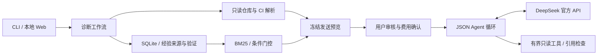

# ExperienceGuard

**AI-powered Software Failure Diagnosis & State-Aware Experience Reuse**

ExperienceGuard 是面向软件研发故障诊断的 AI Agent 应用。通过只读工具读取仓库和 CI 错误日志，结合跨会话历史经验、当前环境条件和证据来源，生成可追溯的诊断建议。

默认 **Evidence Mode** 在本机解析真实文件，无需 API Key。可选 **Agent Mode** 使用 DeepSeek 官方远程 API，通过 JSON 动作协议自主选择工具、多轮取证并引用已读取的证据。

## 核心功能

- **仓库与日志取证**：读取 Git 提交标识、配置和 CI 错误，使用 AST 定位 Python 符号；识别常见 Python、Node.js、Java 与数据库迁移错误。
- **跨会话 Memory**：SQLite 持久化、追加式经验和 JSONL outbox，保留来源、验证方式、内容哈希与替代关系。
- **条件化复用**：BM25 召回后逐项判断 `match / conflict / unknown`。B4 仅允许历史成功且前提全部满足的经验进入复用，Agent 不能越过门控。
- **受控 LLM 闭环**：先审核脱敏披露范围，再确认发送和费用；校验 JSON 动作、工具参数和引用行号，限制请求、Token、时长与累计预算。
- **本地工作台与 CLI**：导入故障、检查证据、审核经验、记录实际验证，并在后续进程中再次检索。

当前使用可解释的规则条件门控；学习型选择器没有作为已验证的生产能力，也未证明 Memory 提升诊断成功率。

## 架构与技术栈



Python、SQLite、标准库 HTTP 服务与原生 JavaScript；jsonschema 校验动作，packaging 比较版本，filelock 保护追加与预算操作。NumPy / SciPy / scikit-learn 用于保留的可选评测和轻量选择器基础模块。默认流程不下载模型、不需要 GPU 或 Agent 框架。

## 安装和启动

建议使用 **Python 3.13** 与 Git。以下 PowerShell 命令在仓库根目录执行：

```powershell
py -3.13 -m venv .venv
$egPython = (Resolve-Path .venv/Scripts/python.exe).Path
& $egPython -m pip install -r requirements.lock.txt
& $egPython -m pip install --no-build-isolation -e .

# 数据目录放在被诊断仓库之外
$egData = Join-Path (Split-Path (Get-Location)) 'experienceguard-data'
& $egPython -m experienceguard doctor
& $egPython -m experienceguard init --data-dir $egData
& $egPython -m experienceguard serve --data-dir $egData --port 8766
```

打开 **http://127.0.0.1:8766**。Linux/macOS 使用 `python3.13 -m venv .venv`，后续解释器路径改为 `.venv/bin/python`。

在工作台依次选择“首次故障”、独立副本验证并保存、“后续会话”、“版本变化”、“信息缺失”，可以观察 Memory 保存、复用、冲突和未知前提。自动测试只执行随包自建示例的可信副本，不执行用户仓库代码。重启时使用相同数据目录即可恢复经验。

## CLI 示例

```powershell
& $egPython -m experienceguard diagnose --data-dir $egData --fixture source
& $egPython -m experienceguard memory --data-dir $egData
& $egPython -m experienceguard cases --data-dir $egData

# 导入自己的本地仓库：显式允许读取范围；日志只作文本处理
& $egPython -m experienceguard diagnose --repo ../sample-repo --log-file ../ci.log --allow-root .. --data-dir $egData

# 各命令的准确参数
& $egPython -m experienceguard agent-preview --help
& $egPython -m experienceguard agent-run --help
```

`diagnose` 返回 `case_id`。使用其中的 `proposal_id` 调用 `verify --case-id ... --proposal-id ...` 可验证自建示例；真实仓库通过工作台记录实际人工验证，标记为 `user_attested`。

## 配置 DeepSeek

可选远程入口沿用已实际接入的 DeepSeek 非 thinking JSON 协议。模型别名 `deepseek-flash` 会随服务更新，不能等同于不可变权重快照。发布整理只进行离线及本机协议验收，不产生新的模型费用。

1. 将 `configs/deepseek.example.json` 复制为 `configs/deepseek.local.json`。
2. 按 [DeepSeek 官方文档](https://api-docs.deepseek.com/) 核实当前服务与价格，填写正数的输入 cache-miss、输出价格上界、核验出处与日期。模板中的零价格会阻止执行。检查总预算、单会话预算和请求上限。
3. 通过安全入口在本机输入 Key，并启动启用远程的工作台：

```powershell
& ./scripts/Start-DeepSeek.ps1 -DataDir $egData
```

Key 只进入该子进程的 `EG_V2_API_KEY`，不会写入配置、命令历史或源码。也可在自行管理的进程环境中设置 `EG_V2_API_KEY`、`EG_V2_REMOTE_ENABLE=true` 和 `EG_DEEPSEEK_CONFIG`，再执行 `serve --enable-remote`。`.env.example` 仅为模板，不会自动加载。

工作台中完成一次诊断，选择允许发送的文件，点击“生成脱敏发送范围预览”，审核所有文本并确认披露和费用后，才能点击“运行远程 Agent”。CLI 使用相同的预览与 SHA 确认流程，见 [运行说明](docs/RUNNING.md)。缺少 Key、配置、授权或精确预览确认时返回 `UNAVAILABLE`，请求数为零。

预算账本 `remote-budget.json` 保存在本地数据目录，进程重启继续累计；失败或不明请求保留预留费用，不自动重试。客户端限额依赖所填价格和供应商用量响应，**不是服务商账单保证**，仍需自行管理账户余额与限制。

## Memory 与安全边界

经验来自实际验证反馈，模型没有“保存成功经验”工具。历史路径不会直接变成当前修复；建议需要结合当前文件与独立验证。引用检查能证明文本已交付给模型，不能证明模型推理或引用语义正确。

默认只监听回环地址，校验 Host / Origin；限制文件类型、体积、符号链接和显式允许目录。Agent 不具备 Shell、安装、写文件或自动修复能力。脱敏是启发式防线，远程发送前仍须人工审核；本地原始证据与数据库可能包含敏感内容，应保存在仓库外。

详见 [架构与 Memory](docs/ARCHITECTURE.md)、[安全说明](docs/SECURITY.md)。

## 验证代码

```powershell
& $egPython -m pytest -q
```

测试源码覆盖只读边界、条件判断、持久化、跨进程复用、Web 接口、JSON Agent 协议及持久预算。HTTP 协议测试为明确标注的脚本响应，不冒充真实 LLM。默认测试不调用付费服务。

## 目录与许可

```text
src/experienceguard/   诊断、Memory、工具、Provider、CLI 与 Web
examples/development/ 自建安全故障示例
configs/              无密钥配置模板
scripts/              本机安全启动入口
tests/                可运行的单元与集成测试
docs/                 安装、架构与安全说明
```

本项目原创代码采用 [MIT](LICENSE)。成熟方法 BM25、AST 解析、版本谓词和逻辑回归不主张原创；项目贡献集中在取证、条件化经验复用与受控 Agent 工作流。公开版本不包含第三方故障源码、模型权重、账户记录或历史研究归档。依赖与可选适配的许可见 [第三方声明](THIRD_PARTY_NOTICES.md)。
